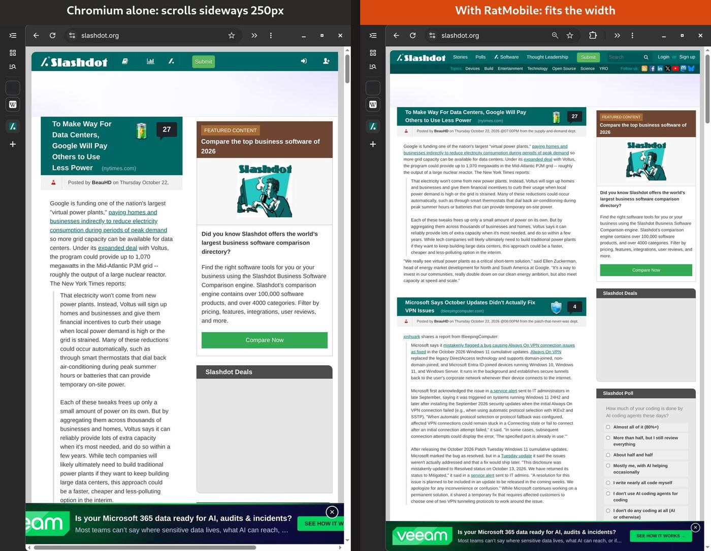
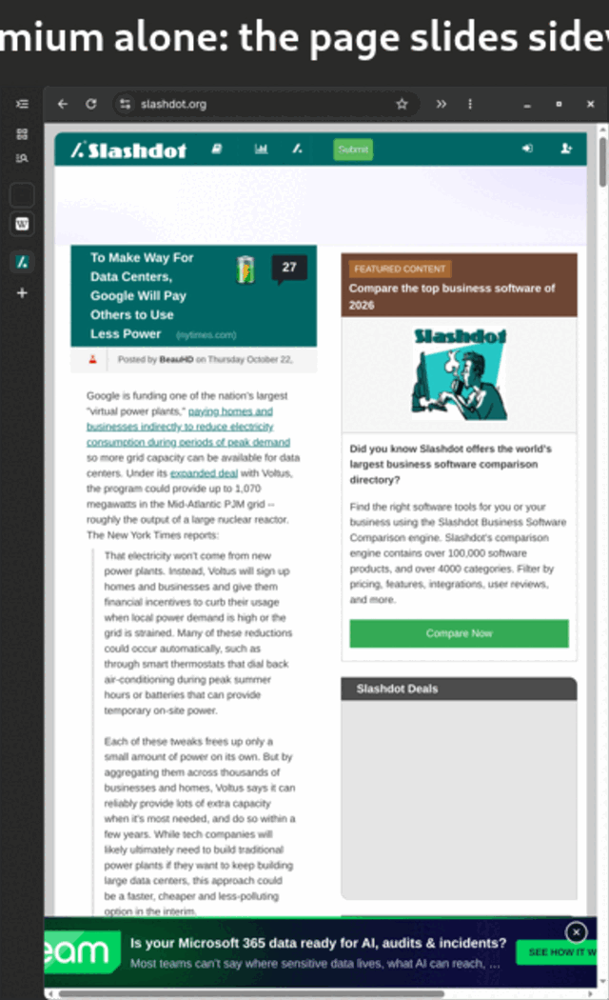
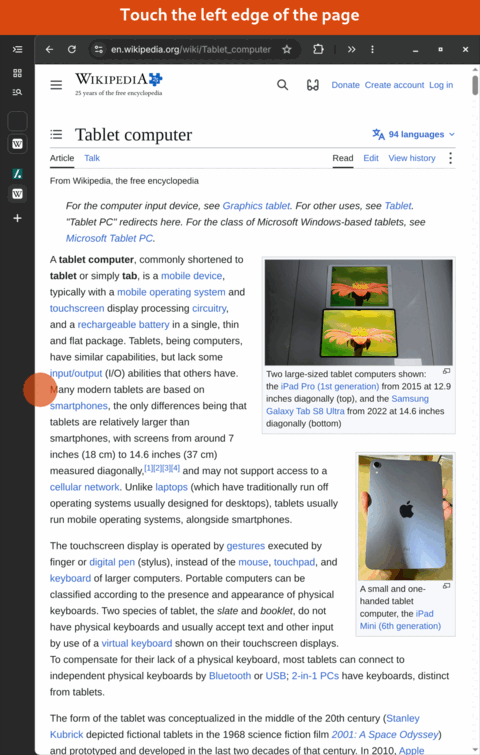

# RatMobile


**A comfortable, tablet-style Chromium.** RatMobile is a Chromium extension. It is not on the Chrome Web Store: you install it in Developer mode or with the installer below, and it updates itself from this repo.

- **Never scroll sideways.** Pages are made to fit the window width, whether in landscape, portrait or split screen.
- **Chromium's own vertical tabs, set up for a tablet.** Collapsed to an icon strip you can always use, expanding over the page on hover to pick a tab, with pinned tabs on top. The installer configures this; RatMobile adds no tab UI of its own.
- **Swipe to open the tabs.** From the left edge of a page, swipe right and the full tab list opens; swipe back and it closes. No reaching for the little expand button.
- **Crash-proof sessions.** Windows, pinned tabs and tab groups are snapshotted continuously and restored after a crash, a `kill -9`, or a forced power-off.

**Install page:** https://dixonsolutions.github.io/RatMobile/

Real Chromium 155, Surface Pro 9 in **portrait** (768 CSS px; the collapsed native tab strip leaves 712 px for the page):



| Replay: the same sideways swipe | Swipe from the edge: Chromium's own tab list |
|---|---|
|  |  |

More: [Wikipedia, Comparison of Linux distributions](docs/screenshots/compare-portrait-wikipedia.jpg) (scrolled 979 px sideways before), [native vertical tabs expanded](docs/screenshots/native-tabs-open.jpg). All captured with `node tests/visual.mjs`, which renders the whole browser window off-screen at the real device resolution.


## Install

| Method | Auto-update | How |
|---|---|---|
| Installer (recommended) | ✅ | Close the browser, run `curl -fsSL https://dixonsolutions.github.io/RatMobile/install.sh \| bash`, start it again (click **Enable** if asked). |
| Developer mode, CRX | ✅ | Download [`ratmobile.crx`](https://dixonsolutions.github.io/RatMobile/ratmobile.crx). On `chrome://extensions`, turn on **Developer mode** and drag the file onto the page **from your file manager**. |
| Developer mode, unpacked | ✅ via timer | `curl -fsSL https://dixonsolutions.github.io/RatMobile/install.sh \| bash -s -- --unpacked`, then **Load unpacked** → `~/.local/share/ratmobile/extension`. |

The installer finds Chromium, Google Chrome and Brave profiles, both native and Flatpak (`~/.var/app/...`). It registers RatMobile's update feed with each through Chromium's per-user `External Extensions` mechanism. Options:

- **Tablet setup** (default for browsers that are closed; `--tablet` to run only that, `--no-tablet` to skip): Chromium's own vertical tabs on, **collapsed** to an icon strip, **expand on hover**, and *On startup → Continue where you left off*. A backup of the settings file is kept next to it.
- **Swipe helper** (always; `--helper` to install only that): a small Python program that presses Chromium's own tab strip shortcut when you swipe (see [Swipe to open the tabs](#swipe-to-open-the-tabs)), registered as a native messaging host with each browser.
- `--uninstall` removes everything the installer added.

### How updates work

Every push to `main` runs [`.github/workflows/release.yml`](.github/workflows/release.yml):

1. Lint the code.
2. Run the end-to-end tests in real headless Chromium.
3. Build version `0.1.<run number>`.
4. Sign the CRX3 with the repo's private key (secret `RATMOBILE_KEY`).
5. Publish `updates.xml` and the CRX to GitHub Pages.
6. Create a GitHub release.

Installed copies pick the new version up through the manifest's `update_url`. Chromium checks every ~5 hours, and RatMobile also nudges it every 3 hours and applies an update the moment one arrives. To update now, click **Update** on `chrome://extensions`. Unpacked installs are refreshed by the installer's systemd user timer, and RatMobile reloads itself when the files change.

The extension ID is always `jlddfageoecfjabhpdkjjbogcnafbdfa`. The public key is in `manifest.json`, so Load unpacked gets the same ID as the CRX and keeps its settings and snapshots.

## Features

### Fit to width: no horizontal scrolling

A content script watches each page with a `ResizeObserver` and a `MutationObserver`. When the document becomes wider than the window, it finds the *root culprits*: elements sticking out past the right edge whose parent does not. It fixes only those:

| Culprit | Fix |
|---|---|
| Images, video, canvas, iframes | `max-width: 100%` (and `height: auto`) |
| `pre` / `code` | wrap long lines |
| Tables | wrap cell text; if still too wide, the table becomes its own scroll box |
| Long words / URLs | `overflow-wrap: anywhere` |
| Single-line flex rows | allow wrapping |
| Full-bleed `100vw` elements | clamp to the column |
| Off-canvas menus parked outside the viewport | clip |
| Fixed-width web apps with no responsive viewport | zoom the tab out to fit, the way a phone shows a desktop site; pinch to zoom in |

Responsive pages are never zoomed. Well-behaved pages are not touched at all, and nothing is ever injected into the page besides one stylesheet. If you zoom a tab yourself (`Ctrl +/−`), RatMobile stops auto-fitting it. To turn fit off for a site, use the switch in the toolbar popup or `Alt+Shift+F`.

### Tabs: Chromium's own vertical tab strip

RatMobile doesn't draw any tab UI. Chromium 146+ has native vertical tabs, and that's what the installer sets up:

| Setting (Chromium preference) | Value | Effect |
|---|---|---|
| `vertical_tabs.enabled` | `true` | Tabs on the side |
| `vertical_tabs.collapsed_state` | `true` | Collapsed to an icon strip that is always usable; pinned tabs as tiles on top |
| `vertical_tabs.expand_on_hover` | `true` | The full list slides over the page while you pick a tab, then collapses again |
| `session.restore_on_startup` | `1` | Continue where you left off |

You can change all of these yourself by right-clicking the tab strip. Extensions can't change them, which is why the installer does it while the browser is closed. Hover only applies to mouse and pen; on a touchscreen, swipe (below) or tap the expand button at the top of the strip.

### Swipe to open the tabs

From the **left edge of the page** (the first 32 px next to the tab strip), **swipe right** and the tab strip expands to the full list. From the same edge, now next to the open list, **swipe left** and it collapses again. It goes the moment your finger has moved 24 px, while you are still swiping, and the strip slides open with Chromium's own animation.

Chromium has no extension API to open or close its tab strip. Its own shortcut does it, though: **Ctrl+Shift+L**. So RatMobile's content script recognises the swipe and its **helper** presses that shortcut for you:

- The helper (`~/.local/share/ratmobile/ratmobile-host`, installed by the installer) is a native messaging host: only RatMobile can talk to it, and the only keys it will ever press are Ctrl+Shift+*letter*. It needs write access to `/dev/uinput`, or a wlroots compositor (sway, Hyprland) whose virtual keyboard it uses instead. The installer checks, and if you can't write to `/dev/uinput` it prints the one-line udev rule that allows it for the logged-in user.
- Turn it on in the toolbar popup (**Swipe to open tabs**), which asks Chromium for permission to talk to the helper. The popup and settings page show whether it works and why not.
- Only a touch that starts at the edge and moves sideways is claimed. Scrolling and pinching from the edge, taps on links there, and Chromium's back/forward swipe anywhere else on the page work as before. RatMobile hides its own Ctrl+Shift+L from the page, so web apps that use that shortcut don't swallow it.
- It works on web pages and local files. Chromium doesn't let extensions run on `chrome://` pages (like the New Tab page) or the Web Store: use the expand button there.

The toolbar button opens a small popup with the per-site *fit to width* switch and the session snapshot history.

### Sessions

Every tab, window and group change is snapshotted to `chrome.storage.local`, debounced to about 0.4 s. Closing windows during a quit never overwrites the last good snapshot. Older snapshots are archived every 10 minutes, and whenever many tabs disappear at once.

After a force shutdown, Chromium itself never auto-restores; it only offers a "Restore pages?" bubble. On the next start RatMobile:

1. Waits for Chromium's startup to settle.
2. Compares the open tabs with the last snapshot.
3. Restores what's missing: windows, pinned tabs first, groups with titles and colours, and the active tab. Background tabs are unloaded until you open them.

If Chromium already restored the session itself, RatMobile does nothing, so tabs are never duplicated. If you also click Chromium's restore bubble, the duplicates it creates are closed.

> Limitation: Chromium doesn't `fsync` extension storage. After a sudden **power loss**, the last few seconds of changes may be lost, and the snapshot from just before that is used.

## Development

```bash
npm ci
node scripts/build.mjs      # dist/ratmobile (unpacked), ratmobile.zip, signed CRX + updates.xml if a key is present
npm run lint
npm test                    # real Chromium, headless, at 1440x960 / 960x1440 / 720x960 @2x
HEADED=1 npm test           # watch it
node tests/sites.mjs        # optional sweep over real websites
node tests/visual.mjs       # before/after screenshots, replay GIFs and the swipe demo of the whole browser window
                            # (native vertical tabs included) at real device resolutions, rendered
                            # off-screen with cage + grim; output in test-results/visual
```

- **Which Chromium the tests use:** `$CHROMIUM` if set, otherwise the Flathub `org.chromium.Chromium`, otherwise Playwright's Chromium.
- **Clean machine:** every profile, temp folder, browser process and compositor socket a test creates is removed when it exits, pass or fail.
- **What the tests cover:**
  - The fit engine on a fixture page for each overflow pattern
  - The toolbar popup (snapshots, restore) and the per-site switch
  - Session restore after a real `SIGKILL` of the browser, repeated crashes, and a graceful quit with *Continue where you left off*
  - CRX install from an update feed, then an auto-update to a newer signed build
  - Tab strip swipes: the helper (it presses nothing but Ctrl+Shift+*letter*; on `/dev/uinput` checked with the device grabbed, so no key reaches the desktop), and real touch swipes in a real Chromium window with its native vertical tabs, off-screen in cage: open, close, no back navigation, scrolling and taps at the edge, back swipe elsewhere. That part is skipped where cage isn't installed (CI).

Signing key: CI reads the `RATMOBILE_KEY` secret. Locally, the build reads `~/.config/ratmobile/key.pem`. Never commit it: whoever has the key can push updates to every install.

## License

MIT. See [LICENSE](LICENSE).
